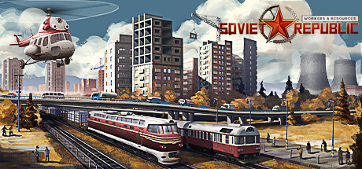

**Workers & Resources: Soviet Republic is the deeply complex Soviet-era city-builder simulation requiring you to develop an entire socialist republic economy including mining, manufacturing, transportation, and social services in meticulous realism.**

---

## 📖 About

Workers & Resources: Soviet Republic is the deeply complex Soviet-era city-builder simulation requiring you to develop an entire socialist republic economy including mining, manufacturing, transportation, and social services in meticulous realism.

## ⚠️ Problems Without Trainer

| Problem | Status |
|---------|--------|
| **Supply Chain Realism** — Every product requires a complete production chain from raw materials | ✅ Solved |
| **Transportation Planning** — Worker commutes require bus routes, trains, and infrastructure planning | ✅ Solved |
| **No Guidance** — Extremely complex game with minimal tutorials; players must discover systems | ✅ Solved |
| **Currency vs Points** — Balancing custom game currency with citizens' needs is intricate | ✅ Solved |

## ✅ Solution

The **Workers & Resources: Soviet Republic Trainer** solves all these issues by giving you complete control over the game.

## 🎯 Full Feature List

- Unlimited Resources
- God Mode / Invincibility
- Instant Skill Cooldown
- One-Hit Kill
- Freeze Game Timer
- Unlock All Items & Achievements
- Custom Speed Multiplier
- Save State Anywhere

## 🚀 Quick Start

1. **Disable Windows Defender** temporarily (trainer may trigger false positive)
2. Download the trainer from the button above
3. Launch Workers & Resources: Soviet Republic
4. Run the trainer as Administrator
5. Activate desired cheats with hotkeys

## 💎 Free vs Paid

| Feature | Free | Pro |
|---------|------|-----|
| Basic God Mode | ✅ | ✅ |
| Unlimited Resources | ✅ | ✅ |
| All Advanced Cheats | ❌ | ✅ |
| Auto-Updates | ❌ | ✅ |
| Priority Support | ❌ | ✅ |

## 💻 Requirements

- Windows 10/11 (64-bit)
- Workers & Resources: Soviet Republic (any version)
- .NET Framework 4.8+
- DirectX 11+

## 🍎 macOS

macOS users can use our alternative tool:

## ⚖️ Legal

This trainer is for educational and single-player use only. Use responsibly.

---

